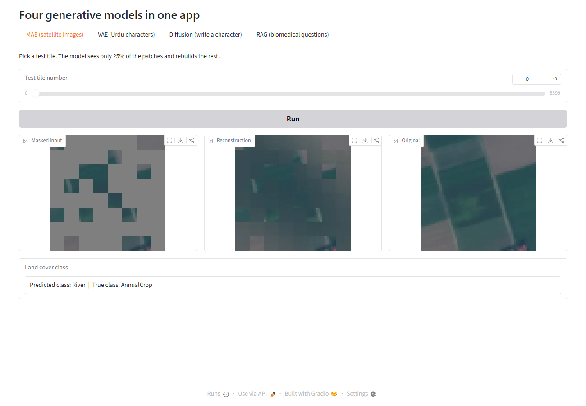
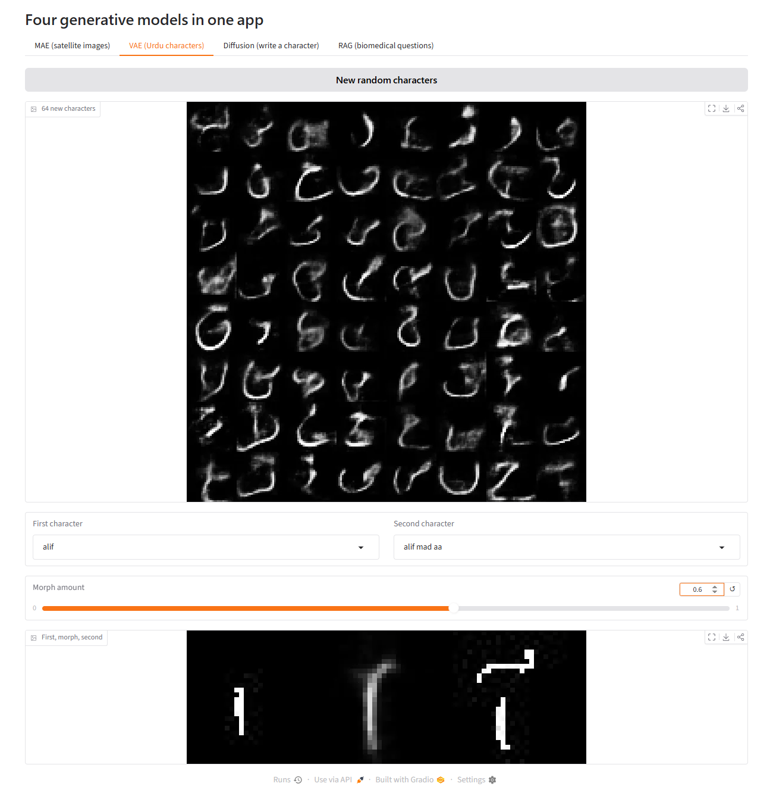
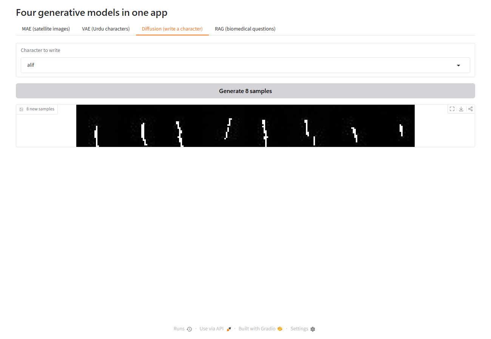
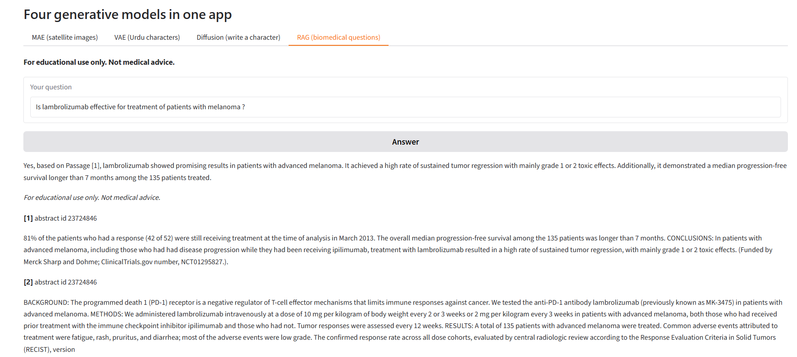

# Masked autoencoder, VAE, diffusion and RAG

Four small generative models and one app.

| Part | Folder | Data |
|---|---|---|
| A: masked autoencoder | part_a_mae | EuroSAT |
| B: variational autoencoder | part_b_vae | UHaT |
| C: diffusion (DDPM) | part_c_diffusion | UHaT |
| D: retrieval augmented generation | part_d_rag | BioASQ |

The folder `starter/` holds the given files and is not changed.

## Setup

```
pip install -r requirements.txt
```

UHaT: download `data.zip` from https://zenodo.org/records/3670611 and unzip it into `starter/data/uhat/`.
EuroSAT and BioASQ download by themselves the first time.

Run every command below from the main folder (the one that holds this README).

The file `GenAI_Assignment_Full.ipynb` holds the whole project in notebook cells (every file is written by a cell) so it can be run on Kaggle without a repository.

## Step by step

Task 0, check the starter code (run it inside the starter folder):

```
cd starter
python check_starter.py
cd ..
```

Part A:

```
python part_a_mae/pretrain.py
python part_a_mae/reconstruct.py
python part_a_mae/classify.py
```

Part B:

```
python part_b_vae/train.py
python part_b_vae/visualize.py
```

Part C:

```
python part_c_diffusion/train.py
python part_c_diffusion/sample.py
python part_c_diffusion/blind_test.py
```

Part D:

```
python part_d_rag/build_index.py
python part_d_rag/eval_retrieval.py
python part_d_rag/eval_generation.py
```

Checks, human evaluation and tables:

```
python tools/run_checks.py
python tools/human_eval.py
python tools/make_tables.py
```

The two members fill `results/human_eval.csv` (the rows for diffusion and for RAG) before `tools/human_eval.py` is run.
The RAG answers to mark are in `results/human_eval_rag_sheet.md`.

App:

```
python app/app.py
```

## Links

Blog: https://medium.com/@f230054/four-ways-to-generate-a-masked-autoencoder-a-vae-a-diffusion-model-and-a-rag-system-all-built-6e23df3415b1

## Results

The tables are in `results/tables.md`, the figures are the `fig_*.png` files in `results/`, the output of Task 0 and its two example grids are in `results/task0_output.txt`, `results/eurosat_examples.png` and `results/uhat_examples.png`, the written answers are in `results/analysis.md`, and the RAG examples are in `results/samples.md`.

## Correctness checks

Output of `python tools/run_checks.py` (also saved in `results/correctness_checks.txt`):

```
----- MAE -----
masked patches in each image: [48.0, 48.0, 48.0, 48.0, 48.0, 48.0]
exactly 48 of 64 masked in every image: True
loss unchanged when a visible patch prediction is changed: True
loss changes when a masked patch prediction is changed: True

----- VAE -----
KL when mu = 0 and logvar = 0: 0.0
smallest KL value over 12800 random cases: 24.894226 (never negative: True)

----- DDPM -----
alpha_bar at the last step: 4.035830352222547e-05 (about 4e-5)
correlation between x0 and the noised image at t = 999: 0.0829 (close to 0, looks like noise)
correlation between x0 and the noised image at t = 0: 0.9999 (close to 1)

----- RAG -----
perfect retriever gives Hit@k = Recall@k = MRR@10 = 1: True
longest chunk in words: 150 (at most 150: True)
embedding norms: min 1.0, max 1.0
```

## App screenshots

MAE tab:



VAE tab:



Diffusion tab:



RAG tab:



## Trained weights

Link: https://drive.google.com/drive/folders/1AvT6TecfoQO10sxwuy4muryRl0j2w5Yr?usp=sharing

Download the four files (mae.pt, mae_classifier.pt, vae.pt, unet.pt) and put them in the folder `weights/`. They are not committed to the repository.
